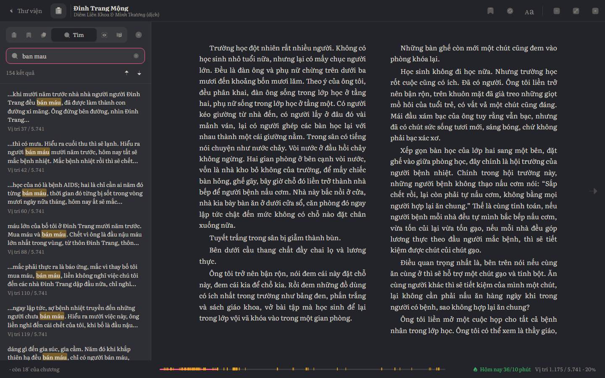
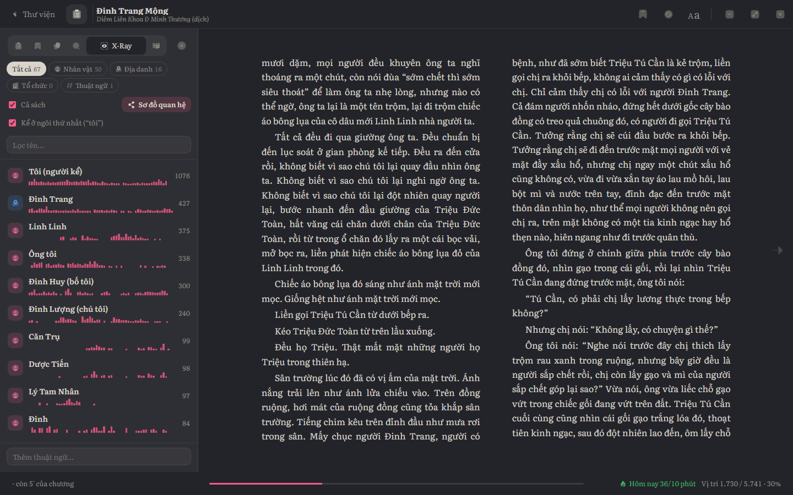

# pntome

**Your Kindle library on Windows and Android, on its own.** pntome signs in to your Amazon account as its own Kindle device, so it does not need the Kindle app, and it also works without an account for the EPUB files on your computer or phone. It puts your books on a 3D bookcase and opens your personal documents in its own reader. The reader comes with highlights, an offline dictionary and an X-Ray of the characters and how they are related. Reading stats track your streak and goals, and weekly, monthly and yearly recaps turn them into a picture you can share.

[Tiếng Việt](README.vi.md) · [User guide (Vietnamese)](docs/huong-dan-su-dung.md) · [Development](docs/development.md)


> **Unofficial.** pntome is a personal project, not made, endorsed or supported by Amazon. It never removes DRM: books you bought from the Kindle Store open in Kindle, and the reader is for the personal documents you sent with Send to Kindle.

## Features

**Library**
- Syncs your Kindle library from Amazon. Books you delete on Kindle disappear here on the next sync.
- Shows books on a 3D bookcase, in a grid or in a list. Search by title or author, sort, and filter purchased books or documents.
- Groups books into shelves by reading status (reading, unread, finished, abandoned). Drag books to reorder them or move them to another shelf, and use the keyboard to do the same.
- Lets you customize each book: title, author, cover (original, typographic or your own image) and spine (colour, material, font, thickness).
- Keeps a reading status for each book and can push it to Kindle: marking a book unread or finished moves its Kindle reading position to the start or the end.
- Sends EPUB files to your Kindle library and devices (Send to Kindle).
- Works without an Amazon account (guest mode). Add EPUB files from your computer with the + button, by drag and drop, or by watching a folder; the app reads their title, author and cover and flags duplicates, DRM and broken files. A local book can be linked with its Kindle copy, and the local library can be exported and imported on another computer.
- Book pages show Goodreads information: rating, number of ratings, genres, the full description and top reviews, with a button to translate reviews into Vietnamese.

**Reader** (for personal documents)
- Turns pages with a page-curl animation, the arrow keys or the mouse wheel. Shows one or two pages, and has paper, sepia, dark and black themes plus font, size, spacing and margin settings.
- Syncs your reading position with Kindle in both directions: it can jump to the furthest page read on any Kindle device, and it pushes its own position back to Amazon.
- Has highlights in four colours and notes. Highlights made on Kindle are always pulled in; yours go back to Kindle when that setting is on. Hovering over a highlight shows its note.
- Shows footnotes in a popup when you hover over the footnote mark.
- Finds text anywhere in the book (Ctrl+F). It ignores diacritics and highlights every match, with marks on the progress bar.
- Has a table of contents, bookmarks, a reading-time counter for today and the time left in the chapter.

**Words**
- Selecting a word shows its meaning straight away from an offline dictionary (Vietnamese–Vietnamese, English–Vietnamese, English–English), with tabs for Wiktionary and Wikipedia and spoken pronunciation.
- Saves words to a vocabulary notebook, with the sentence they came from and a link back to the page.

**X-Ray**
- Finds the characters, places, organisations and terms in a book offline. Everything stops at the page you are on, so nothing ahead is spoiled.
- For books told in the first person ("I"), adds the narrator and the people they call "my father" or "my uncle".
- Draws a relationship map of the characters. Ties are coloured by kind (family, romance, conflict, acquaintance) and labels never overlap. You can zoom, pan and drag people around.
- Optionally uses AI to label relationships and describe characters, with Claude or DeepSeek and your own API key. It shows the cost first and sends only short passages from the part you have read. Names the AI says are one person are merged, and you can undo it.
- Shows a card when you hover over a name in the text. You can rename, merge, split, retype or hide anything.

**Reading stats and streaks**
- Counts your reading time from the app and, as an estimate, from Kindle devices and apps, plus paper-book time you type in yourself.
- A daily goal and a streak (one missed day a week is forgiven), a yearly book goal drawn as the real spines of the books you finished, and a streak calendar that shows the cover of each day's book.
- Reading time for 7 or 30 days, books finished by month, the books you spent most time on, your genres (17 groups, from Goodreads and Amazon, changeable per book), the hours you read at, a short reader profile and 13 badges. View one year or all time.
- On desktop, the flame in the title bar opens a streak popover; clicking a day in the calendar shows what you read that day.

**Weekly, monthly and yearly recaps**
- From the evening of the last day of a week, month or year, a recap card waits on the home screen; past recaps stay in Stats.
- Each card has a generated background, 3D stickers chosen from your numbers that you can move, turn, resize or add, six colour themes, and story or post format. The year recap has six pages.
- Save it as a picture, copy it (desktop) or share it (Android).

**Android**
- A phone layout with bottom tabs (Home, Library, Vocabulary, Account), the book page as a bottom sheet and an immersive reader: tap zones, swipes or page-curl turns that follow your finger, six reading themes.
- Long-press a word for the dictionary, select a passage to highlight, tap a footnote to read it.
- Sign in to Amazon inside the app, or use guest mode with EPUB files from the phone.

## Screenshots

| | |
|---|---|
|  |  |
| Select a word: highlight colours and the dictionary | Find in book, ignoring diacritics |
|  |  |
| X-Ray, up to the page you are on | The relationship map |


## Install and run

Download the Windows installer (`pntome_x.y.z_x64-setup.exe`) or the Android APK from [Releases](https://github.com/crushonublu/pinknbook/releases). The Windows app updates itself; on Android, install a newer APK over the old one.

pntome is a [Tauri 2](https://tauri.app) app (Rust + React). It runs on **Windows 10/11** with the WebView2 runtime, which Windows 11 already has, and on **Android 7** or later (saving pictures to the gallery needs Android 10).

To build it yourself you need [Node.js](https://nodejs.org) 20 or later and [Rust](https://rustup.rs) (stable).

```bash
cd app
npm install
npm run tauri dev      # run in development
npm run tauri build    # build an installer (app/src-tauri/target/release/bundle)
```

On first start, click **Sign in to Amazon**, then **Sync library**, or choose to use the app without signing in. See the [user guide](docs/huong-dan-su-dung.md) for the rest, and [docs/release.md](docs/release.md) for building the Android APK.

## Your data

- **On your computer:** the library, positions, highlights, vocabulary, X-Ray, stats and recaps live in `%APPDATA%\com.pinknbook.app`, together with the downloaded books, the covers and the dictionary. On Android they stay in the app's private storage, which is not backed up to the cloud.
- **In Windows Credential Manager** (the Keystore-protected store on Android): the Amazon device credentials and any AI API keys.
- **Goodreads:** the app looks up the books you open, and a few of the books you read recently in the background, to show their information and genres.
- **Sent to an AI provider:** nothing, unless you press an AI button: in the relationship map, or "Rewrite with AI" on the reader profile. Even then, the map sends only short passages from the part you have already read, after showing you the estimated cost, and the profile sends only a handful of numbers.

## Built with

Tauri 2 · Rust (rusqlite, reqwest, rsa) · React 19 + TypeScript + Vite · [foliate-js](https://github.com/johnfactotum/foliate-js) (book rendering, MIT) · Wiktionary data via [kaikki.org](https://kaikki.org) (CC BY-SA) · [Open English WordNet](https://en-word.net) (CC BY 4.0) · Literata font · Reicon icons · 3D stickers by [3dicons / Reicon](https://3dicons.reicon.dev).

## License

No license has been chosen yet; all rights reserved until one is added. Third-party parts keep their own licenses (see `app/public/foliate/LICENSE`).
