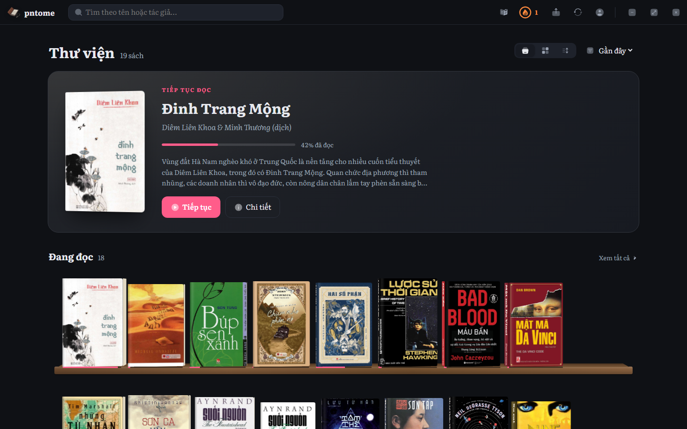
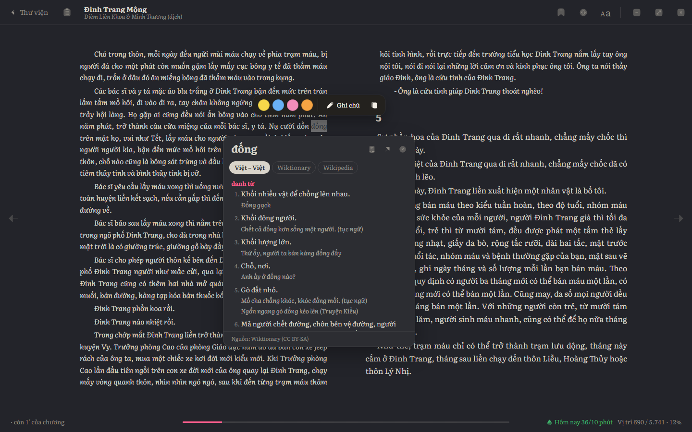
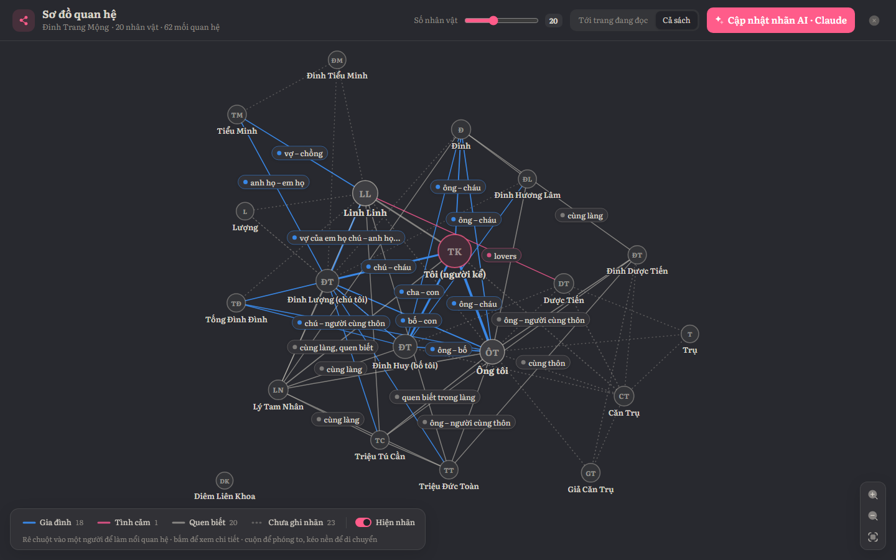
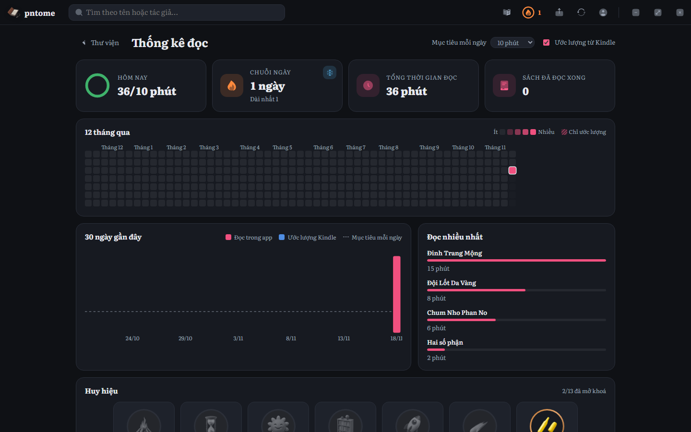

# pntome

**Your Kindle library on Windows, on its own.** pntome signs in to your Amazon account as its own Kindle device, so it does not need the Kindle app. It puts your books on a 3D bookcase and opens your personal documents in its own reader. The reader comes with highlights, an offline dictionary and an X-Ray of the characters and how they are related.

[Tiếng Việt](README.vi.md) · [User guide (Vietnamese)](docs/huong-dan-su-dung.md) · [Development](docs/development.md)



> **Unofficial.** pntome is a personal project, not made, endorsed or supported by Amazon. It never removes DRM: books you bought from the Kindle Store open in Kindle, and the reader is for the personal documents you sent with Send to Kindle.

## Features

**Library**
- Syncs your Kindle library from Amazon. Books you delete on Kindle disappear here on the next sync.
- Shows books on a 3D bookcase, in a grid or in a list. Search by title or author, sort, and filter purchased books or documents.
- Groups books into shelves by reading status (reading, unread, finished, abandoned). Drag books to reorder them or move them to another shelf, and use the keyboard to do the same.
- Lets you customize each book: title, author, cover (original, typographic or your own image) and spine (colour, material, font, thickness).
- Keeps a reading status for each book and can push it to Kindle: marking a book unread or finished moves its Kindle reading position to the start or the end.
- Sends EPUB files to your Kindle library and devices (Send to Kindle).

**Reader** (for personal documents)
- Turns pages with a page-curl animation, the arrow keys or the mouse wheel. Shows one or two pages, and has paper, sepia, dark and black themes plus font, size, spacing and margin settings.
- Syncs your reading position with Kindle in both directions: it can jump to the furthest page read on any Kindle device, and it pushes its own position back to Amazon.
- Has highlights in four colours and notes. Highlights made on Kindle are always pulled in; yours go back to Kindle when that setting is on. Hovering over a highlight shows its note.
- Shows footnotes in a popup when you hover over the footnote mark.
- Finds text anywhere in the book (Ctrl+F). It ignores diacritics and highlights every match, with marks on the progress bar.
- Has a table of contents, bookmarks, a reading-time counter for today and the time left in the chapter.

**Words**
- Selecting a word shows its meaning straight away from an offline dictionary (Vietnamese–Vietnamese, English–Vietnamese, English–English), with tabs for Wiktionary and Wikipedia and spoken pronunciation.
- Saves words to a vocabulary notebook, with the sentence they came from and a link back to the page.

**X-Ray**
- Finds the characters, places, organisations and terms in a book offline. Everything stops at the page you are on, so nothing ahead is spoiled.
- For books told in the first person ("I"), adds the narrator and the people they call "my father" or "my uncle".
- Draws a relationship map of the characters. Ties are coloured by kind (family, romance, conflict, acquaintance) and labels never overlap. You can zoom, pan and drag people around.
- Optionally uses AI to label relationships and describe characters, with Claude or DeepSeek and your own API key. It shows the cost first and sends only short passages from the part you have read. Names the AI says are one person are merged, and you can undo it.
- Shows a card when you hover over a name in the text. You can rename, merge, split, retype or hide anything.

**Reading stats**
- Tracks a daily goal and a streak, total time, a 12-month heatmap, the books you read most and 13 badges.
- Includes estimates of the time you read on Kindle devices.

## Screenshots

| | |
|---|---|
|  |  |
| Select a word: highlight colours and the dictionary | Find in book, ignoring diacritics |
|  |  |
| X-Ray, up to the page you are on | The relationship map |



## Install and run

pntome is a [Tauri 2](https://tauri.app) app (Rust + React). It runs on **Windows 10/11** with the WebView2 runtime, which Windows 11 already has.

You need [Node.js](https://nodejs.org) 20 or later and [Rust](https://rustup.rs) (stable).

```bash
cd app
npm install
npm run tauri dev      # run in development
npm run tauri build    # build an installer (app/src-tauri/target/release/bundle)
```

On first start, click **Sign in to Amazon**, then **Sync library**. See the [user guide](docs/huong-dan-su-dung.md) for the rest.

## Your data

- **On your computer:** the library, positions, highlights, vocabulary, X-Ray and stats live in `%APPDATA%\com.pinknbook.app`, together with the downloaded books, the covers and the dictionary.
- **In Windows Credential Manager:** the Amazon device credentials and any AI API keys.
- **Sent to an AI provider:** nothing, unless you press the AI button in the relationship map. Even then, the app sends only short passages from the part you have already read, after showing you the estimated cost.

## Built with

Tauri 2 · Rust (rusqlite, reqwest, rsa) · React 19 + TypeScript + Vite · [foliate-js](https://github.com/johnfactotum/foliate-js) (book rendering, MIT) · Wiktionary data via [kaikki.org](https://kaikki.org) (CC BY-SA) · [Open English WordNet](https://en-word.net) (CC BY 4.0) · Literata font · Reicon icons.

## License

No license has been chosen yet; all rights reserved until one is added. Third-party parts keep their own licenses (see `app/public/foliate/LICENSE`).
