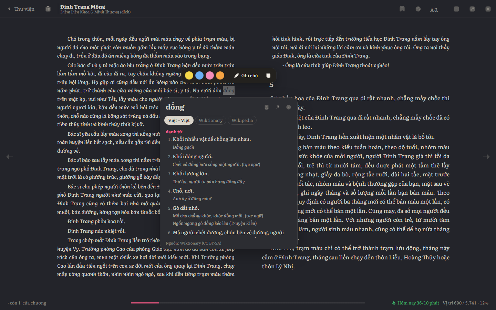
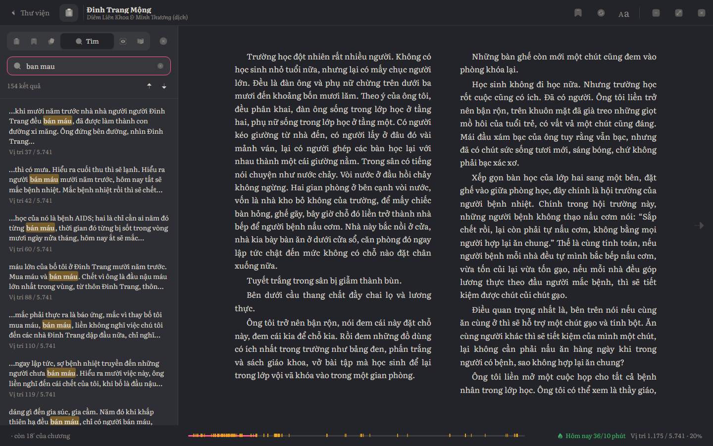
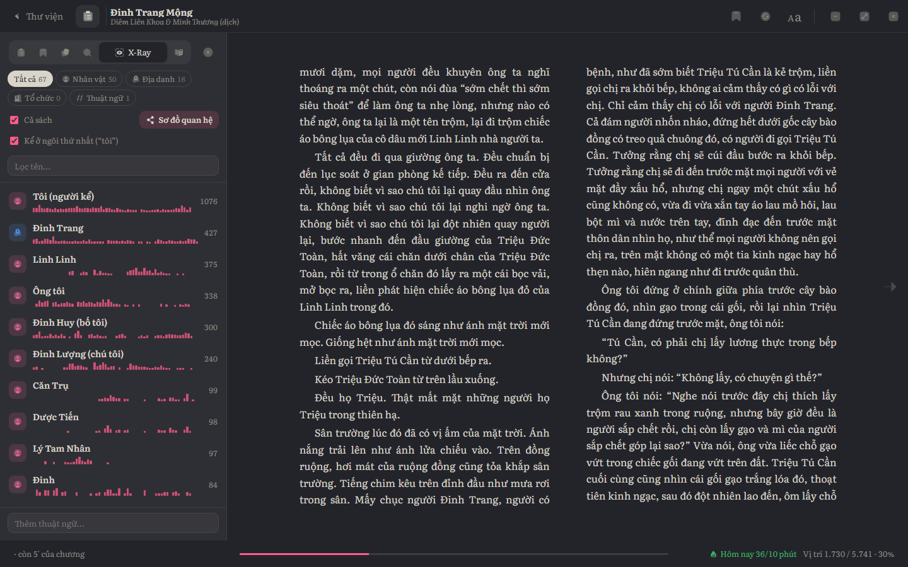
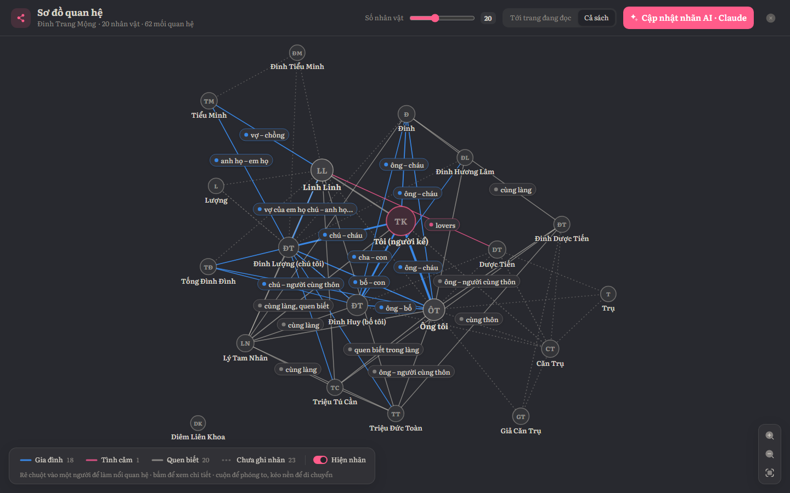
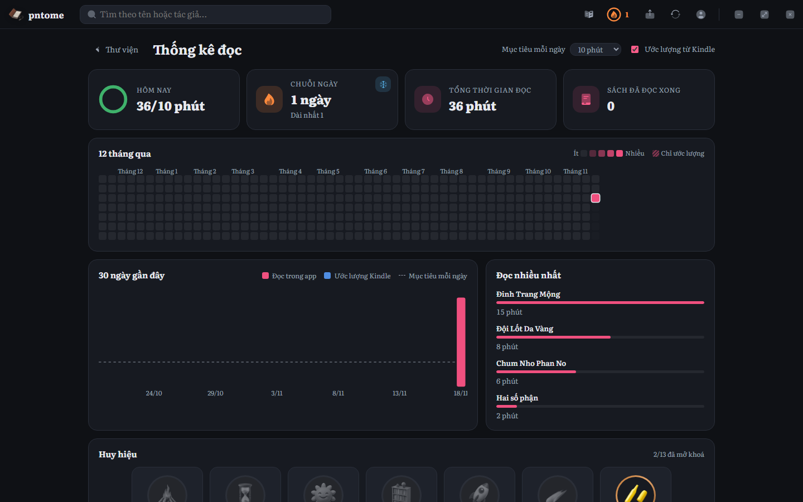

# pntome

**Thư viện Kindle của bạn trên Windows, độc lập.** pntome đăng nhập tài khoản Amazon như một thiết bị Kindle riêng, nên không cần cài app Kindle. App bày sách lên kệ 3D và mở tài liệu cá nhân trong trình đọc riêng. Trình đọc có đánh dấu, từ điển offline và X-Ray nhân vật kèm sơ đồ quan hệ.

[English](README.md) · [Hướng dẫn sử dụng](docs/huong-dan-su-dung.md) · [Phát triển](docs/development.md)


> **Không chính thức.** pntome là dự án cá nhân, không do Amazon làm, bảo trợ hay hỗ trợ. App không gỡ DRM: sách mua trên Kindle Store mở bằng Kindle, còn trình đọc dành cho tài liệu cá nhân bạn gửi qua Send to Kindle.

## Tính năng

**Thư viện**
- Đồng bộ thư viện Kindle từ Amazon. Sách bạn xoá trên Kindle sẽ biến mất ở lần đồng bộ sau.
- Xem sách trên kệ 3D, dạng lưới hoặc danh sách. Tìm theo tên và tác giả, sắp xếp, lọc sách mua hoặc tài liệu.
- Xếp sách thành các kệ theo trạng thái đọc (đang đọc, chưa đọc, đã xong, bỏ dở). Kéo thả để sắp xếp hoặc chuyển kệ, hoặc làm bằng bàn phím.
- Tuỳ chỉnh từng cuốn: tên, tác giả, bìa (bìa gốc, bìa chữ, ảnh của bạn) và gáy sách (màu, chất liệu, kiểu chữ, độ dày).
- Trạng thái đọc có thể đẩy lên Kindle: đánh dấu "chưa đọc" hay "đã xong" sẽ đưa vị trí đọc trên Kindle về đầu hoặc cuối sách.
- Gửi file EPUB vào thư viện và các máy Kindle (Send to Kindle).

**Trình đọc** (cho tài liệu cá nhân)
- Lật trang có hiệu ứng cuộn giấy, bằng phím mũi tên hoặc cuộn chuột. Đọc một hoặc hai trang; màu trang giấy trắng, giấy cũ, xám tối hoặc đen; chỉnh kiểu chữ, cỡ chữ, giãn dòng, lề.
- Đồng bộ vị trí đọc với Kindle cả hai chiều: nhảy tới trang xa nhất đã đọc trên mọi máy Kindle, và đẩy vị trí của mình lên Amazon.
- Đánh dấu bốn màu kèm ghi chú. Đánh dấu làm trên Kindle luôn được lấy về; đánh dấu của bạn được gửi lên Kindle khi bật tuỳ chọn. Rê chuột vào đoạn đã đánh dấu để xem ghi chú.
- Rê chuột vào số chú thích là hiện nội dung chú thích.
- Tìm chữ trong cả cuốn (Ctrl+F), gõ không dấu cũng tìm được chữ có dấu. Mọi kết quả đều được tô màu, kèm vạch trên thanh tiến độ.
- Có mục lục, dấu trang, số phút đã đọc hôm nay và thời gian còn lại của chương.

**Từ vựng**
- Bôi đen một từ là hiện nghĩa ngay, từ từ điển offline (Việt–Việt, Anh–Việt, Anh–Anh), có thêm tab Wiktionary, Wikipedia và nghe phát âm.
- Lưu từ vào Sổ từ, kèm câu chứa nó và đường dẫn về đúng trang.

**X-Ray**
- Tự dò nhân vật, địa danh, tổ chức và thuật ngữ, không cần mạng. Mọi thứ chỉ tính tới trang đang đọc, nên không lộ nội dung phía sau.
- Sách kể ở ngôi thứ nhất có thêm "Tôi (người kể)" và những người được gọi là "bố tôi", "chú tôi"…
- Vẽ sơ đồ quan hệ nhân vật. Đường nối tô màu theo loại quan hệ (gia đình, tình cảm, xung đột, quen biết), nhãn không chồng lên nhau. Có thể phóng to, kéo nền, kéo từng người.
- Tuỳ chọn dùng AI (Claude hoặc DeepSeek, key của bạn) để ghi nhãn quan hệ và viết giới thiệu nhân vật. App báo chi phí trước và chỉ gửi đoạn ngắn trong phần đã đọc. Những tên AI cho là cùng một người được tự gộp, và có nút hoàn tác.
- Rê chuột vào tên trong sách là hiện thẻ giới thiệu. Đổi tên, gộp, tách, đổi loại hay ẩn đều được.

**Thống kê đọc**
- Mục tiêu mỗi ngày và chuỗi ngày, tổng thời gian, bản đồ nhiệt 12 tháng, sách đọc nhiều nhất và 13 huy hiệu.
- Có ước lượng cả thời gian đọc trên máy Kindle.

## Ảnh chụp

| | |
|---|---|
|  |  |
| Bôi đen một từ: màu đánh dấu và từ điển | Tìm trong sách, gõ không dấu |
|  |  |
| X-Ray, tính tới trang đang đọc | Sơ đồ quan hệ |



## Cài đặt và chạy

pntome là app [Tauri 2](https://tauri.app) (Rust + React), chạy trên **Windows 10/11** có WebView2 (Windows 11 có sẵn).

Cần [Node.js](https://nodejs.org) 20 trở lên và [Rust](https://rustup.rs) (bản stable).

```bash
cd app
npm install
npm run tauri dev      # chạy thử
npm run tauri build    # đóng gói bộ cài (app/src-tauri/target/release/bundle)
```

Lần đầu mở app, bấm **Đăng nhập Amazon**, rồi **Đồng bộ thư viện**. Phần còn lại xem trong [hướng dẫn sử dụng](docs/huong-dan-su-dung.md).

## Dữ liệu của bạn

- **Trên máy bạn:** thư viện, vị trí đọc, đánh dấu, sổ từ, X-Ray và thống kê nằm trong `%APPDATA%\com.pinknbook.app`, cùng sách đã tải, ảnh bìa và từ điển.
- **Trong Windows Credential Manager:** khoá thiết bị Amazon và API key AI.
- **Gửi cho nhà cung cấp AI:** không có gì, trừ khi bạn bấm nút AI trong sơ đồ quan hệ. Khi đó app chỉ gửi đoạn ngắn trong phần bạn đã đọc, sau khi báo chi phí ước tính.

## Công nghệ

Tauri 2 · Rust (rusqlite, reqwest, rsa) · React 19 + TypeScript + Vite · [foliate-js](https://github.com/johnfactotum/foliate-js) (hiển thị sách, MIT) · dữ liệu Wiktionary qua [kaikki.org](https://kaikki.org) (CC BY-SA) · [Open English WordNet](https://en-word.net) (CC BY 4.0) · font Literata · icon Reicon.

## Giấy phép

Chưa chọn giấy phép; trước khi có, mọi quyền được bảo lưu. Các thành phần bên thứ ba giữ giấy phép riêng (xem `app/public/foliate/LICENSE`).
