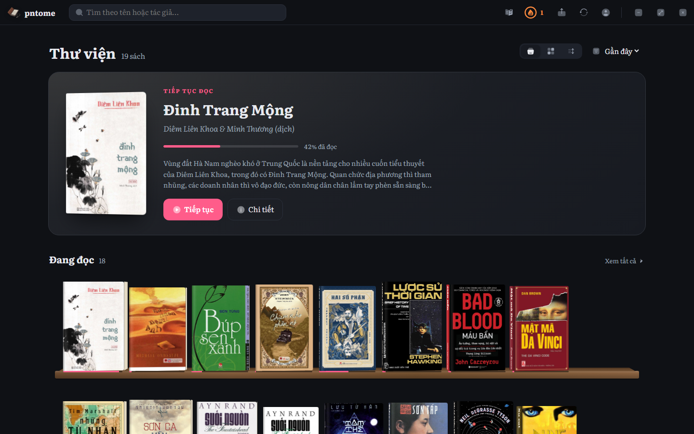
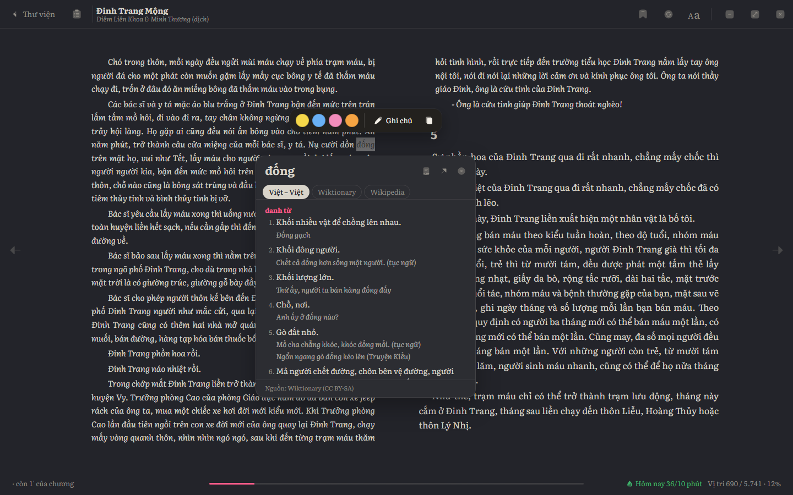
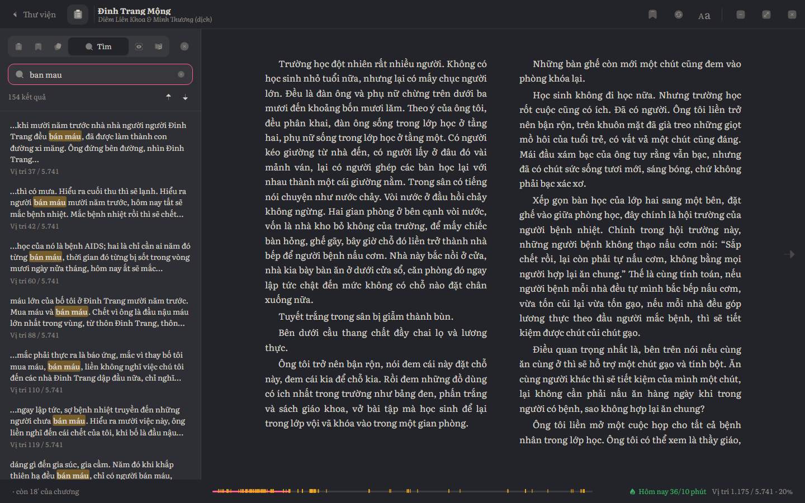
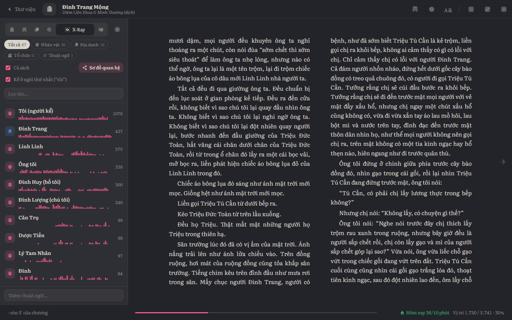
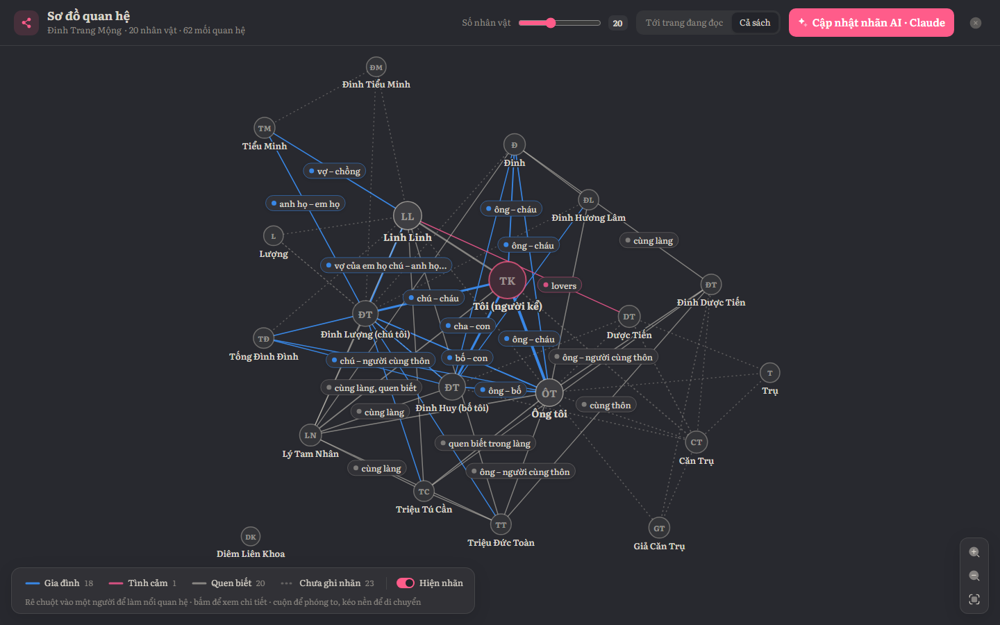
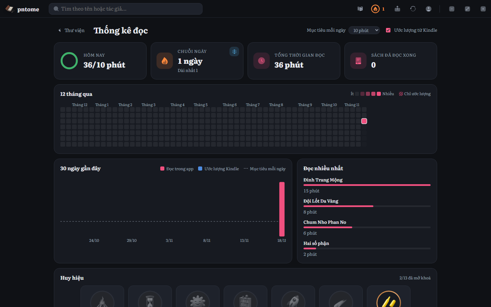

# Hướng dẫn sử dụng pntome

pntome là app đọc và quản lý thư viện Kindle trên Windows và Android. Tài liệu này đi qua từng phần của app theo thứ tự bạn sẽ gặp chúng; những chỗ khác trên điện thoại được ghi ở [mục 13](#13-dùng-trên-android).

- [1. Bắt đầu](#1-bắt-đầu)
- [2. Thư viện](#2-thư-viện)
- [3. Đọc sách](#3-đọc-sách)
- [4. Đánh dấu và ghi chú](#4-đánh-dấu-và-ghi-chú)
- [5. Tìm trong sách](#5-tìm-trong-sách)
- [6. Từ điển và Sổ từ](#6-từ-điển-và-sổ-từ)
- [7. X-Ray](#7-x-ray)
- [8. Sơ đồ quan hệ](#8-sơ-đồ-quan-hệ)
- [9. Dùng AI cho X-Ray](#9-dùng-ai-cho-x-ray)
- [10. Gửi lên Kindle](#10-gửi-lên-kindle)
- [11. Thống kê, chuỗi ngày đọc và huy hiệu](#11-thống-kê-chuỗi-ngày-đọc-và-huy-hiệu)
- [12. Tổng kết tuần, tháng, năm](#12-tổng-kết-tuần-tháng-năm)
- [13. Dùng trên Android](#13-dùng-trên-android)
- [14. Phím tắt](#14-phím-tắt)
- [15. Dữ liệu và quyền riêng tư](#15-dữ-liệu-và-quyền-riêng-tư)
- [16. Câu hỏi thường gặp](#16-câu-hỏi-thường-gặp)

---

## 1. Bắt đầu

1. Mở app, bấm **Đăng nhập Amazon**. Một cửa sổ đăng nhập của Amazon hiện ra; đăng nhập như bình thường.
2. Sau khi đăng nhập, app đăng ký với Amazon như **một thiết bị Kindle mới** (tên thiết bị hiện trong menu Tài khoản, mục "Thiết bị này"). Bạn sẽ thấy thiết bị này trong trang *Manage Your Content and Devices* của Amazon.
3. Bấm **Đồng bộ thư viện** (biểu tượng mũi tên tròn trên thanh tiêu đề) để kéo sách về. Ảnh bìa và thông tin sách được lấy dần ở chế độ nền.

Không có tài khoản Amazon, hoặc chỉ muốn đọc EPUB trên máy? Bấm **Dùng không cần đăng nhập** ở màn hình đầu. App chạy ở **chế độ khách**; bạn có thể đăng nhập Amazon bất cứ lúc nào từ menu Tài khoản.

Menu **Tài khoản** (biểu tượng người ở góc phải) có:
- **Ngôn ngữ:** Tiếng Việt hoặc English.
- **Giao diện:** sáng hoặc tối.
- **Sách trên máy:** dung lượng, thư mục tự thêm sách mới, xuất/nhập thư viện (xem [Sách trên máy](#sách-trên-máy)).
- **Kiểm tra cập nhật** (bản Windows): app cũng tự kiểm tra lúc mở và đề nghị **Cập nhật ngay** khi có bản mới.
- **Đăng xuất:** về chế độ khách, chọn giữ hay xoá dữ liệu Kindle trên máy.

## 2. Thư viện

### Xem và tìm sách
- **Kệ sách / Lưới / Danh sách:** ba nút ở góc phải trên.
- **Tìm:** gõ tên sách hoặc tác giả vào ô tìm trên thanh tiêu đề.
- **Sắp xếp:** Gần đây, Tên, Tác giả, Tiến độ.
- **Lọc:** Tất cả, Sách mua, Tài liệu.
- **Tiếp tục đọc:** khối lớn ở đầu trang là cuốn bạn đọc gần nhất. Bấm **Tiếp tục** để mở ngay.

### Kệ theo trạng thái
Ở chế độ Kệ sách, sách được xếp thành các kệ **Đang đọc**, **Chưa đọc**, **Đã đọc xong** và **Bỏ dở**.
- Kéo một cuốn để đổi thứ tự hoặc thả sang kệ khác.
- Bàn phím: ←/→ để chọn sách, Alt+←/→ để dời sách trong kệ, Alt+↑/↓ để chuyển sang kệ khác, Enter hoặc Space để mở, **I** để xem chi tiết.

Trạng thái mặc định được suy từ tiến độ đọc (chế độ **Tự động**); bạn có thể đặt tay trong phần chi tiết sách. Khi đặt thành **Chưa đọc** hoặc **Đã đọc xong**, app hỏi có muốn đẩy lên Kindle không. Kindle không có nhãn trạng thái, nên app đưa vị trí đọc trên Kindle về đầu sách hoặc tới cuối sách. Bạn cũng có thể chọn **Chỉ đổi trong app**.

### Chi tiết và tuỳ chỉnh sách
Bấm **Chi tiết** (hoặc phím I) để xem giới thiệu, ngôn ngữ, thể loại, tiến độ và lần đọc cuối. Từ đây mở **Tuỳ chỉnh sách** để:
- sửa **tên sách** và **tác giả** (ví dụ tài liệu có tác giả là địa chỉ email), có nút **Khôi phục** về bản gốc từ Amazon;
- đổi **bìa**: bìa gốc, bìa chữ hoặc ảnh trên máy;
- chỉnh **gáy sách** trên kệ: màu (mặc định theo bìa), chất liệu (trơn, vải, da, nhũ vàng), kiểu chữ (có chân, không chân, in hoa) và độ dày.

Mọi thay đổi chỉ lưu trong app, không sửa sách trên Amazon.

Trang chi tiết còn có:
- **Thông tin Goodreads:** điểm, số lượt đánh giá, thể loại, mô tả đầy đủ và nhận xét nổi bật; nút **Dịch** đưa nhận xét sang tiếng Việt.
- **Thể loại** dùng cho thống kê: mặc định **Tự động** (lấy từ Goodreads, rồi tới chủ đề Amazon). Chọn một trong 17 nhóm nếu app đoán sai, hoặc chọn lại Tự động.

### Sách mua và tài liệu
- **Tài liệu** (sách bạn gửi qua Send to Kindle) mở trong trình đọc của app.
- **Sách mua** có DRM: app không gỡ DRM, nên những cuốn này đọc trên Kindle.

### Sách trên máy
App đọc được file **EPUB** trên máy, có hay không đăng nhập Amazon.
- Thêm sách bằng nút **+** trên thanh tiêu đề, kéo thả file hoặc cả thư mục vào cửa sổ, hoặc đặt **thư mục tự thêm sách mới** trong *Tài khoản → Sách trên máy*. App sao chép sách vào thư mục dữ liệu riêng, đọc tên, tác giả và bìa, và báo rõ file trùng, có DRM hoặc hỏng.
- Sách trên máy có đủ đánh dấu, ghi chú, dấu trang, từ điển, X-Ray, sổ từ và thống kê như tài liệu Kindle.
- Có thể **liên kết** một cuốn trên máy với bản Kindle cùng tên (gộp thành một thẻ), hoặc gửi nó lên Kindle từ trang sách.
- *Sách trên máy* trong menu Tài khoản cho **xuất/nhập** cả thư viện để chuyển sang máy khác.

## 3. Đọc sách

### Lật trang
- Phím **←/→** hoặc **Page Up/Page Down**.
- **Cuộn chuột** (cả bàn di chuột): mỗi nấc là một trang.
- Bấm **mũi tên** hai bên trang. Khi bật hiệu ứng lật trang cuộn giấy, có thể **kéo góc trang** để lật như sách thật.
- **Thanh tiến độ** ở dưới: kéo để tới vị trí bất kỳ.

### Thanh trên
- **Thư viện:** quay về thư viện (hoặc Esc).
- **Mục lục và dấu trang** (phím **T**): mở thanh bên với các tab Mục lục, Dấu trang, Ghi chú, Tìm, X-Ray và Từ.
- **Dấu trang** (phím **B**): đánh dấu hoặc bỏ đánh dấu trang đang xem.
- **Đồng bộ tới vị trí đọc xa nhất trên Kindle:** app hỏi Amazon xem bạn đã đọc tới đâu trên các máy Kindle, rồi đề nghị nhảy tới đó.
- **Aa (Tuỳ chỉnh trang đọc):**
  - Màu trang: theo app, giấy trắng, giấy cũ, xám tối, đen.
  - Kiểu chữ, cỡ chữ, giãn dòng, lề trang.
  - Bố cục một trang hoặc hai trang; căn đều hai bên.
  - Hiệu ứng lật trang cuộn giấy.
  - Bật/tắt tra từ điển, X-Ray, gửi đánh dấu lên Kindle, cùng API key cho AI.

### Thanh dưới
Thời gian còn lại của chương, số phút đã đọc hôm nay so với mục tiêu, vị trí (theo cách đếm của Kindle) và phần trăm.

### Vị trí đọc trên Kindle
Khi bạn đóng sách, app gửi vị trí hiện tại lên Amazon, nên mở cuốn đó trên Kindle sẽ được đề nghị nhảy tới đúng chỗ.

### Chú thích
Rê chuột vào số chú thích (ví dụ `[3]`) là nội dung chú thích hiện ngay cạnh, không cần nhảy trang.

## 4. Đánh dấu và ghi chú

Bôi đen một đoạn, thanh công cụ nhỏ hiện ra:
- chọn một trong **bốn màu** (vàng, xanh, hồng, cam) để đánh dấu;
- **Ghi chú** để viết ghi chú (Ctrl+Enter để lưu);
- **Sao chép** đoạn đã chọn.

Bấm vào một đoạn đã đánh dấu để đổi màu, sửa ghi chú hoặc xoá. Rê chuột vào đoạn có ghi chú là ghi chú hiện lên.

Tab **Ghi chú** ở thanh bên liệt kê mọi đánh dấu của cuốn sách, có lọc "Có ghi chú" và "Chưa lên Kindle".
- Đánh dấu làm trên Kindle luôn được lấy về.
- Muốn đánh dấu làm trong app cũng lên Kindle, bật **Gửi đánh dấu lên Kindle** trong Aa, rồi bấm **Đồng bộ Kindle** ở tab Ghi chú.
- Sách định dạng cũ không có bản đồ vị trí của Kindle, nên đánh dấu của những sách này chỉ lưu trong app.

## 5. Tìm trong sách

Bấm **Ctrl+F** (hoặc mở tab **Tìm** ở thanh bên) và gõ.
- Gõ **không dấu** vẫn tìm được chữ có dấu: "ban mau" tìm ra "bán máu".
- Mỗi kết quả kèm một đoạn ngữ cảnh và vị trí. **Enter** tới kết quả sau, **Shift+Enter** về kết quả trước.
- Mọi kết quả trên trang đang xem đều được tô màu, và thanh tiến độ có vạch ở những chỗ có kết quả.

## 6. Từ điển và Sổ từ

### Tra từ
Bôi đen **một từ** (hoặc một cụm ngắn) là bảng nghĩa hiện ngay. App tự ghép theo từ điển, nên bôi "đống" trong "chất đống" vẫn ra đúng mục.

Các tab:
- **Việt – Việt**, **Anh – Việt**, **Anh – Anh:** từ điển offline. App tự đoán tab theo từ bạn chọn.
- **Wiktionary** và **Wikipedia:** cần mạng.

Ngoài ra có:
- **Từng tiếng / Cả cụm:** với từ ghép tiếng Việt, xem nghĩa cả cụm hay từng tiếng.
- **Nghe phát âm** và **Mở trang đầy đủ** (mở nguồn trên trình duyệt).

**Lần đầu tra**, app hỏi tải dữ liệu từ điển: Wiktionary tiếng Việt và Open English WordNet, tải về rồi dựng thành từ điển trên máy. Việc này chỉ làm một lần.

Không muốn bảng nghĩa tự hiện khi bôi đen? Tắt **Tra từ điển** trong Aa.

### Sổ từ
Bấm **Lưu vào Sổ từ** trong bảng nghĩa. App lưu từ, nghĩa, câu chứa nó và vị trí trong sách.
- Tab **Từ** ở thanh bên: các từ đã lưu của cuốn đang đọc.
- Nút **Sổ từ** trên thanh tiêu đề: mọi từ đã lưu.
  - Lọc theo sách và ngôn ngữ.
  - Chia hai nhóm **Đang học** và **Đã thuộc**.
  - **Mở chỗ này trong sách** để quay về đúng trang.

## 7. X-Ray

Mở tab **X-Ray** ở thanh bên. Lần đầu, app đọc cả cuốn để dò tên (mất vài giây). Việc này chạy hoàn toàn trên máy, không cần mạng.

### Danh sách
- Các nhóm: **Nhân vật**, **Địa danh**, **Tổ chức**, **Thuật ngữ**. Mỗi tên có số lần xuất hiện và một dải nhỏ cho thấy tên đó xuất hiện ở đâu trong phần đã đọc.
- **Chống lộ nội dung:** mặc định mọi thứ chỉ tính **tới trang đang đọc**. Bật **Cả sách** nếu bạn đã đọc xong hoặc không ngại spoiler.
- **Thêm thuật ngữ:** gõ một từ hay cụm từ ở ô cuối danh sách, app tìm nó trong cả cuốn.

### Chi tiết một tên
Bấm vào một tên để xem:
- loại, số lần xuất hiện, lần đầu xuất hiện;
- giới thiệu (của AI nếu đã chạy, hoặc câu đầu tiên nhắc tới), nút tra Wikipedia;
- **Cách gọi:** các tên khác nhau của cùng một người. Bấm × để **tách** một cách gọi ra, hoặc **Gộp vào…** một tên khác;
- **Quan hệ** với những người hay xuất hiện cùng;
- **Các đoạn nhắc tới:** bấm để nhảy tới đoạn đó trong sách.

Bạn có thể **đổi tên** (bấm đúp vào tên), **đổi loại** (ví dụ Nhân vật sang Địa danh) hoặc **ẩn** tên dò nhầm. Mọi chỉnh sửa được lưu và giữ qua các lần mở.

### Trong trang sách
Rê chuột vào một tên trong sách là thẻ giới thiệu ngắn hiện ra (loại, số lần, giới thiệu, vài quan hệ). Thanh tiến độ cũng có vạch ở những chỗ tên đang chọn xuất hiện.

### Sách kể ở ngôi thứ nhất
App tự nhận ra sách kể bằng "tôi" (hoặc "I") và thêm:
- **Tôi (người kể)**: nhân vật kể chuyện;
- những người người kể gọi theo quan hệ: **Bố tôi**, **Ông tôi**, **Chú tôi**…, nối sẵn với người kể bằng nhãn bố – con, ông – cháu, chú – cháu.

Nếu app đoán sai, bật hoặc tắt **Kể ở ngôi thứ nhất ("tôi")** trong tab X-Ray.

## 8. Sơ đồ quan hệ

Trong tab X-Ray, bấm **Sơ đồ quan hệ**. Hai người được nối với nhau khi hay xuất hiện trong cùng đoạn văn; đường càng đậm thì họ càng hay đi cùng nhau.

**Màu đường nối** theo loại quan hệ:

| Kiểu đường | Loại quan hệ |
|---|---|
| Xanh dương | Gia đình |
| Hồng | Tình cảm |
| Vàng hổ phách, nét đứt | Xung đột |
| Xám liền | Quen biết |
| Chấm mờ | Chưa ghi nhãn |

Bấm vào một loại ở **chú giải** (góc dưới trái) để ẩn hoặc hiện loại đó. Công tắc **Hiện nhãn** bật/tắt nhãn chữ trên đường nối.

**Thao tác:**
- **Rê chuột** vào một người: những người không liên quan mờ đi, nhãn quan hệ của người đó hiện ra.
- **Bấm** vào một người: mở bảng bên phải với giới thiệu và danh sách quan hệ. Ở đây có nút **Xem trong X-Ray**, và các nút đổi sang Địa danh / Tổ chức / Thuật ngữ / Ẩn nếu đó không phải nhân vật.
- **Bấm** vào một đường nối hoặc nhãn: xem các đoạn hai người cùng xuất hiện và sửa **Nhãn quan hệ** theo ý bạn. Nhãn bạn tự gõ luôn được ưu tiên hơn nhãn AI.
- **Cuộn chuột** để phóng to/thu nhỏ, **kéo nền** để di chuyển, **kéo một người** để đổi chỗ. Góc phải dưới có nút phóng to, thu nhỏ, vừa khung.
- **Số nhân vật:** thanh trượt trên cùng (mặc định 20 người xuất hiện nhiều nhất).
- **Tới trang đang đọc / Cả sách:** chọn phạm vi như trong X-Ray.
- **Esc** đóng bảng bên phải, rồi đóng sơ đồ.

## 9. Dùng AI cho X-Ray

AI ghi nhãn quan hệ (ví dụ "cha – con", "vợ – chồng") và viết vài câu giới thiệu cho mỗi nhân vật. Phần này **tuỳ chọn** và tốn phí theo tài khoản AI của bạn.

### Cài đặt
1. Mở **Aa** trong trình đọc, phần **AI cho X-Ray**.
2. Chọn nhà cung cấp: **Claude** (Anthropic) hoặc **DeepSeek**.
3. Dán **API key** rồi bấm **Lưu**. Key được cất trong Windows Credential Manager, không nằm trong file nào của app.

### Chạy
1. Trong sơ đồ quan hệ, bấm **Ghi nhãn bằng AI** (lần sau là **Cập nhật nhãn AI**).
2. App cho biết sẽ gửi bao nhiêu cặp, bao nhiêu nhân vật, bao nhiêu đoạn văn, cùng **chi phí ước tính**. Bấm **Gửi** để chạy, hoặc **Huỷ**.
3. App gửi từng đợt nhỏ, hiện tiến độ, và lưu kết quả sau mỗi đợt.

### Gửi đi những gì
- Chỉ những **đoạn ngắn** có các nhân vật, lấy từ **phần bạn đã đọc** (hoặc cả sách nếu bạn chọn Cả sách).
- Lần sau chỉ gửi phần mới đọc thêm.
- AI được dặn không dùng hiểu biết sẵn có về cuốn sách và không tiết lộ nội dung phía sau.
- Nhãn và giới thiệu viết bằng ngôn ngữ của app.

### Tự gộp tên
AI có thể nhận ra hai tên là **cùng một người**, ví dụ "Tú Cần" và "Triệu Tú Cần", hay "Bố tôi" và "Đinh Huy". App chỉ **tự gộp** những trường hợp hợp lý về mặt tên:
- một tên nằm trọn trong tên kia;
- hoặc người kể / "bố tôi"… được gán cho một tên thật.

App không bao giờ tự gộp một **họ** (như "Đinh", "Lý"). Các trường hợp khác chỉ hiện thành gợi ý "Có thể là một người" kèm nút gộp để bạn tự quyết. Sau khi tự gộp, đầu sơ đồ có thông báo kèm nút **Hoàn tác**. Bạn cũng có thể tách lại bất cứ lúc nào ở mục **Cách gọi** trong X-Ray.

## 10. Gửi lên Kindle

Bấm nút **Gửi lên Kindle** (mũi tên lên) trên thanh tiêu đề.
1. **Thêm EPUB** hoặc kéo thả file EPUB vào cửa sổ. App kiểm tra file trước khi gửi: phải là EPUB hợp lệ, không có DRM, dưới 200 MB.
2. Sửa **tên sách**, **tác giả** và **bìa** nếu muốn.
3. Chọn **máy Kindle** sẽ nhận sách (lựa chọn này được nhớ cho lần sau). Không chọn máy nào thì sách chỉ vào thư viện Kindle.
4. Bấm **Gửi**. Amazon chuyển đổi file rồi đưa vào thư viện; sách tự xuất hiện ở kệ **Chưa đọc** khi xong.

## 11. Thống kê, chuỗi ngày đọc và huy hiệu

Ngọn lửa trên thanh tiêu đề cho biết **chuỗi ngày** hiện tại; vòng quanh nó là phần mục tiêu hôm nay đã đọc. Bấm vào để mở **popover chuỗi**: phút đã đọc hôm nay, số phút còn thiếu, bảy ngày trong tuần, chuỗi dài nhất, lá chắn tuần này và nút **Mở thống kê**.

**Thời gian được tính thế nào**
- **Trong pntome:** thời gian bạn thật sự đọc (bỏ qua lúc để yên quá 3 phút).
- **Trên Kindle (ước tính):** khi app mở, cứ 30 phút app xem vị trí đọc trên Kindle đã đi xa bao nhiêu và đổi ra phút theo tốc độ đọc của bạn. Amazon chỉ cho biết vị trí cuối, nên phần đọc trước khi cài pntome không có. Tắt bằng **Ước tính thời gian đọc trên Kindle**.
- **Sách giấy:** bấm **Thêm thời gian đọc sách giấy** (khi xem một ngày trên lịch; hoặc nút **Sách giấy** ở đầu trang Thống kê trên máy tính, mục Sách giấy trong **Cài đặt thống kê** trên điện thoại), chọn ngày (hôm nay hoặc 7 ngày trước), chọn sách trong thư viện hoặc gõ tên sách giấy, rồi nhập số phút. Mỗi ngày có danh sách các lần nhập để xoá nếu nhầm.
- Một ngày tính từ **4 giờ sáng**, nên đọc khuya vẫn tính cho tối hôm trước.

**Chuỗi và mục tiêu**
- **Chuỗi ngày:** số ngày liên tiếp đạt **mục tiêu mỗi ngày**. Mỗi tuần có **1 lá chắn**: lỡ một ngày vẫn giữ chuỗi.
- **Mục tiêu năm:** số cuốn muốn đọc xong trong năm, vẽ thành kệ sách bằng gáy thật của những cuốn đã xong, chỗ còn thiếu là khung nét đứt. App cho biết bạn đang đúng tiến độ hay chậm mấy cuốn.
- Đổi hai mục tiêu và bật/tắt ước tính Kindle ở đầu trang Thống kê.

**Trang Thống kê** (chọn **Tất cả** hoặc từng năm):
- **Hồ sơ đọc:** một hai câu tóm tắt thói quen (cú đêm hay dậy sớm, thể loại chính, so với kỳ trước). Đã có API key AI thì có thêm nút **Viết lại bằng AI**.
- **Hôm nay** và tuần này, **mục tiêu năm**.
- **Lịch chuỗi:** chuỗi dài nhất, mỗi ngày đã đọc hiện bìa cuốn đọc nhiều nhất hôm đó; ô màu nhấn là các ngày của chuỗi đang giữ. Dải 12 tháng bên dưới để chọn tháng. Bấm một ngày để xem đọc bao lâu (trong app, Kindle, sách giấy), những cuốn nào, bao nhiêu đánh dấu, ghi chú và từ mới.
- **Thời gian đọc** 7 hoặc 30 ngày, **sách đọc xong theo tháng**, **sách đọc lâu nhất**, **thể loại** (biểu đồ tròn, 5 nhóm lớn nhất), **giờ hay đọc** trong ngày.
- **Huy hiệu:** 13 huy hiệu chia bốn nhóm (thời gian, sách, đánh dấu, thói quen), mỗi huy hiệu có các cấp Đồng, Bạc, Vàng, Kim cương.

Thể loại lấy từ Goodreads, nên những cuốn chưa có thông tin Goodreads hiện là "chưa rõ". App tự tra dần vài cuốn mỗi lần ở chế độ nền; bạn cũng có thể chọn thể loại ở trang chi tiết sách.

## 12. Tổng kết tuần, tháng, năm

Từ **18 giờ ngày cuối tuần** (Chủ nhật), **ngày cuối tháng** hoặc **31/12**, Trang chủ có thẻ "Tổng kết … đã sẵn sàng". Trước khi kỳ kết thúc, số liệu ghi là *tạm tính*; sang kỳ mới, số liệu được chốt và lưu lại. Thẻ tuần hiện tới hết tuần sau, thẻ tháng tới ngày 7, thẻ năm tới hết tháng 1. Bấm × để ẩn thẻ.

Trong màn tổng kết:
- **Màu thẻ** (sáu màu), **Đổi nền** (nền hình khối sinh ngẫu nhiên), khổ **Story** hoặc **Bài đăng**.
- **Sticker:** app tự đặt sticker 3D theo số liệu (ngọn lửa cho chuỗi dài, mặt trăng cho cú đêm, cúp khi đạt mục tiêu…). Kéo để di chuyển; trên máy tính dùng tay nắm ở góc để xoay và phóng to, trên điện thoại dùng hai ngón. **Thêm sticker** mở khay icon và huy hiệu của bạn; **Xếp lại tự động** đặt lại từ đầu; có nút xoá và hoàn tác.
- Tổng kết năm có sáu trang: tổng quan, sách đã đọc, thể loại, chuỗi và lịch, giờ đọc, huy hiệu.
- **Lưu ảnh:** máy tính mở hộp thoại lưu file PNG; Android lưu vào Ảnh (thư mục Pictures/pntome, cần Android 10).
- **Sao chép** (máy tính) hoặc **Chia sẻ…** (Android) để gửi ảnh sang app khác.

Mọi bản đã chốt nằm ở mục **Các bản tổng kết** cuối trang Thống kê (trên máy tính còn có nút **Tổng kết** ở đầu trang), xếp theo năm; xoá được nếu không cần.

## 13. Dùng trên Android

Bản Android có cùng thư viện, trình đọc, từ điển, X-Ray, thống kê và tổng kết, với giao diện cho điện thoại:
- **Tab dưới:** Trang chủ, Thư viện, Sổ từ, Tài khoản. Trang chủ có thẻ chuỗi ngày, mục tiêu năm, thẻ tổng kết và cuốn đang đọc.
- **Trang sách** trượt lên từ dưới, có nút **Tiếp tục đọc**.
- **Trình đọc toàn màn hình:** chạm giữa để hiện thanh, chạm hai bên hoặc vuốt để lật trang; kiểu lật Curl, Trượt hoặc không hiệu ứng. Nút **Menu** góc dưới phải mở mục lục, tìm, X-Ray, từ đã lưu và sáu giao diện (Kindle, Giấy cũ, Thoáng, Đậm, Đêm, Rừng).
- **Giữ một từ** để tra từ điển; **bôi đen một đoạn** để hiện thanh đánh dấu; chạm vào đoạn đã đánh dấu để sửa; chạm số chú thích để đọc chú thích.
- Nút **Quay lại** của Android đóng bảng đang mở, rồi đóng sách, rồi về Trang chủ.
- **Đăng nhập Amazon** mở trang đăng nhập của Amazon ngay trong app; hoặc dùng chế độ khách và thêm EPUB bằng trình chọn file của điện thoại.
- Chưa có trên Android: Gửi lên Kindle, kéo thả, thư mục tự thêm sách, xuất thư viện. App Android chưa tự cập nhật: tải APK mới ở trang Releases và cài đè lên bản cũ.

## 14. Phím tắt

| Ở đâu | Phím | Việc |
|---|---|---|
| Trình đọc | ← / → hoặc Page Up / Page Down | Trang trước / sau |
| Trình đọc | Cuộn chuột | Lật trang |
| Trình đọc | T | Mở/đóng thanh bên (mục lục, dấu trang…) |
| Trình đọc | B | Đánh dấu / bỏ dấu trang này |
| Trình đọc | Ctrl+F | Tìm trong sách |
| Trình đọc | Esc | Đóng bảng đang mở, rồi về thư viện |
| Ô tìm trong sách | Enter / Shift+Enter | Kết quả sau / trước |
| Ghi chú | Ctrl+Enter | Lưu ghi chú |
| Kệ sách | ← / →, Home / End | Chọn sách |
| Kệ sách | Alt+← / Alt+→ | Dời sách trong kệ |
| Kệ sách | Alt+↑ / Alt+↓ | Chuyển sách sang kệ khác |
| Kệ sách | Enter / Space | Mở sách |
| Kệ sách | I | Xem chi tiết sách |
| Sơ đồ quan hệ | Cuộn chuột | Phóng to / thu nhỏ |
| Sơ đồ quan hệ | Esc | Đóng bảng bên, rồi đóng sơ đồ |
| Tổng kết (sticker đang chọn) | Phím mũi tên (Shift: bước lớn) | Dời sticker |
| Tổng kết (sticker đang chọn) | [ / ] · + / - | Xoay · phóng to / thu nhỏ |
| Tổng kết (sticker đang chọn) | Delete · Esc | Xoá sticker · bỏ chọn |

## 15. Dữ liệu và quyền riêng tư

- **Dữ liệu trên máy:** `%APPDATA%\com.pinknbook.app`.
  - `pinknbook.sqlite`: thư viện, vị trí đọc, đánh dấu, dấu trang, sổ từ, X-Ray, thống kê, các bản tổng kết.
  - `books\`: tài liệu đã tải và sách trên máy.
  - `covers\`: ảnh bìa.
  - `dict\`: từ điển offline.
- Trên Android, dữ liệu nằm trong bộ nhớ riêng của app và không được sao lưu lên mây.
- **Khoá đăng nhập Amazon** và **API key AI** nằm trong **Windows Credential Manager** (trên Android: kho bảo mật dùng Keystore).
- **Đăng xuất** xoá khoá thiết bị khỏi máy. Muốn huỷ hẳn thiết bị pntome khỏi tài khoản, vào *Manage Your Content and Devices* trên Amazon.
- Ngoài Amazon, app chỉ kết nối trong mấy trường hợp sau:
  - tải dữ liệu từ điển (một lần);
  - mở tab Wiktionary / Wikipedia;
  - tra Goodreads cho sách bạn mở, và vài cuốn bạn mới đọc ở chế độ nền (để lấy thể loại);
  - dịch nhận xét Goodreads khi bạn bấm Dịch;
  - kiểm tra bản cập nhật trên GitHub (bản Windows);
  - chạy AI khi bạn bấm nút (sơ đồ quan hệ, hoặc Viết lại bằng AI ở hồ sơ đọc, chỉ gửi vài con số).

## 16. Câu hỏi thường gặp

**Sao không mở được sách mua?**
Sách mua trên Kindle Store có DRM, và app không gỡ DRM. Trình đọc dành cho tài liệu cá nhân (gửi qua Send to Kindle hoặc nút Gửi lên Kindle).

**Tôi xoá sách trên Kindle mà app vẫn còn?**
Bấm **Đồng bộ thư viện**. Những sách không còn trên Amazon sẽ được bỏ khỏi thư viện; đánh dấu và thống kê của chúng vẫn được giữ.

**X-Ray nhận nhầm địa danh thành nhân vật?**
Mở tên đó và đổi loại. Trong sơ đồ quan hệ, bấm vào người đó rồi chọn Địa danh / Tổ chức / Thuật ngữ / Ẩn.

**AI báo "câu trả lời quá dài"?**
App đã tự chia nhỏ và thử lại; phần làm được vẫn được lưu. Bấm **Cập nhật nhãn AI** để chạy tiếp phần còn lại.

**Sao thống kê không có thời gian tôi đọc Kindle trước đây?**
Amazon chỉ cho biết vị trí đọc cuối của mỗi cuốn, không cho biết bạn đọc ngày nào. App chỉ ước tính được phần đọc trên Kindle kể từ khi pntome bắt đầu theo dõi, và chỉ khi app được mở (30 phút một lần, cho 10 cuốn đọc gần nhất). Đọc sách giấy thì tự nhập bằng **Thêm thời gian đọc sách giấy**.

**Nhiều sách "chưa rõ thể loại"?**
Thể loại lấy từ Goodreads; app tra dần vài cuốn mỗi lần. Mở trang chi tiết sách để tra ngay, hoặc tự chọn thể loại ở đó.

**Lưu ảnh tổng kết báo cần Android 10?**
Lưu vào Ảnh dùng cách lưu của Android 10 trở lên. Trên máy cũ hơn, dùng **Chia sẻ…** rồi chọn app lưu ảnh.

**AI gộp nhầm hai người?**
Bấm **Hoàn tác** ở thông báo trên sơ đồ, hoặc mở người đó trong X-Ray và bấm × ở cách gọi bị gộp nhầm. Cặp đã tách sẽ không bị tự gộp lại.
